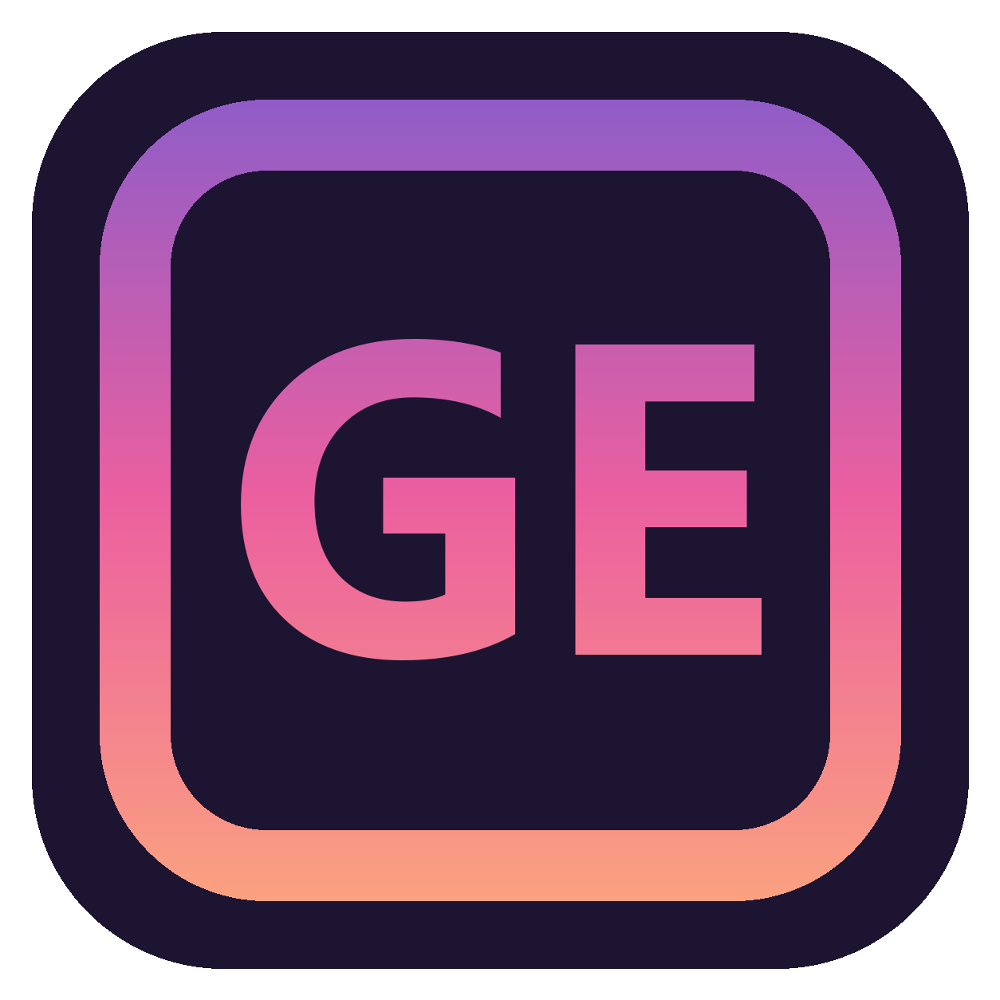
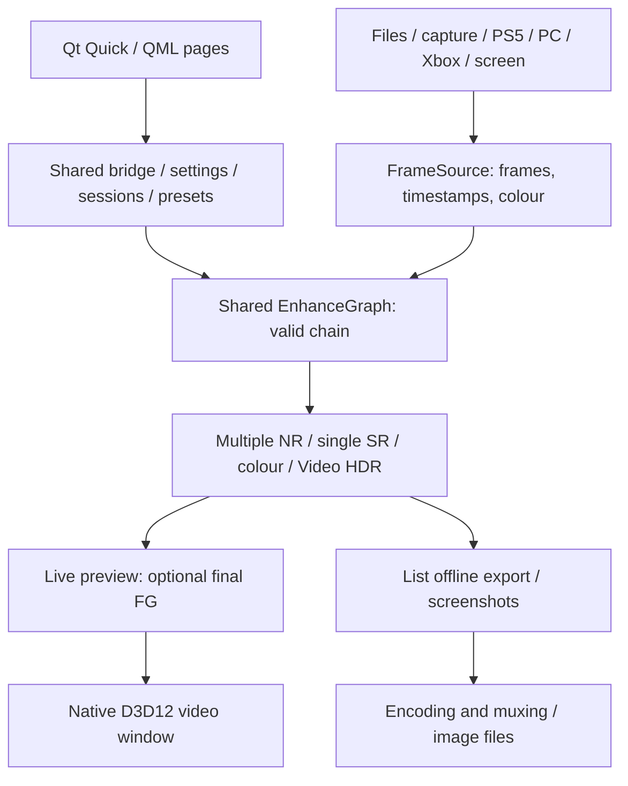

# Graphic Enhancement

**Real-time GPU video enhancement for Windows**

Super resolution · Denoising · HDR · Frame generation · Capture · PS5 / Xbox / PC streaming

**English** · [Türkçe](README.tr.md) · [🌐 Website in your language](https://nedimdmir.github.io/GraphicEnhancement/)

Graphic Enhancement turns local video, capture cards and game streaming into one real-time GPU
enhancement pipeline. It runs on Windows 11 with DirectX 12 on NVIDIA and AMD GPUs.

> **Derived work.** Graphic Enhancement is a modified version of
> [Veyra](https://github.com/Likely7/Veyra-NRVideo) (upstream commit
> `bc59d457ce0b87141f3db2ebafb0f4812b1cea39`), released under the GNU GPL v3.
> The product was renamed and rebranded, upstream promotional material was removed and the
> changes listed below were applied. See [NOTICE.md](NOTICE.md) for details. All original
> copyright and license notices are kept in [LICENSE](LICENSE), [licenses/](licenses) and
> [THIRD_PARTY_NOTICES.md](THIRD_PARTY_NOTICES.md).

## Download

Every push to `main` is built by GitHub Actions. Open the latest successful
[Windows build](https://github.com/nedimdmir/GraphicEnhancement/actions/workflows/windows-build.yml)
run and download the ZIP under **Artifacts** (a GitHub sign-in is required by GitHub for
artifact downloads). Extract it to a normal folder and run `graphicenhancement_qml_ui.exe`.

The CI package does **not** contain NVIDIA/AMD proprietary runtimes and AI models (DLSS, DLSS 5
neural rendering, VFG, RTX Video, FSR, AMD NR). The GPU driver alone does not provide them; without
them playback, colour and display features work, but those enhancements stay unavailable.

## Features

- **Sources:** video files, capture cards, PS5 Remote Play, PC streaming (Moonlight/Sunshine
  compatible), Xbox (experimental) and screen capture.
- **Enhancement:** super resolution (DLSS / XeSS / FSR / NIS / VideoSR), up to four layered
  denoise passes, DLSS 5 neural rendering (NR), RTX Video HDR, anti-aliasing, colour grading
  (curves, wheels, LUTs).
- **Frame generation:** DLSS FG, NVIDIA VFG, FSR, XeSS, RIFE, AMD FRC; display sync and VRR.
- **Editing modes:** Professional List mode and an executable Node editor.
- **Export:** ordered queue, trimming, MP4/MKV, multiple audio and subtitle tracks.
- **Extras:** live captions and translation, recording, instant replay, OBS filter, virtual camera.
- **14 interface languages:** English, Türkçe, 简体中文, 繁體中文, 日本語, 한국어, Español, Français,
  Deutsch, Português (Brasil), Русский, Italiano, Polski, Bahasa Indonesia.

## Changes compared to upstream

1. **Lower input lag by default.** On first start the low-latency presentation queue
   (1 frame instead of 3) is on, and NVIDIA Low Latency (Reflex) is on where available.
   Existing saved settings are kept. Both can be changed in Pro mode.
2. **New languages:** Turkish, Italian, Polish and Indonesian.
3. **Launcher rollback only after an update.** Upstream rolled back to the previous version
   whenever the program exited with an error in its first 15 seconds, on any start. It now
   rolls back only on the first start of a freshly installed update.
4. **CI builds and tests every push.** Unit tests that need no GPU run in CI; compiler errors are
   reported as annotations.
5. **Update signature test.** A valid signed manifest is accepted and a tampered one is rejected.
6. **WebVTT parsing.** Cues written without a blank line between them are no longer dropped.
7. **Build fix.** The non-CUDA build of the VFG backend compiles again.
8. **One atomic file writer.** Preset, session and UI preference files use the shared
   `writeSmallFile` helper (write to a temporary file, flush, then replace).

## Requirements

Windows 11 x64 and DirectX 12. GPU and capture drivers are installed separately. Start with all
effects off, check picture and sound, then enable effects one by one. High resolutions, layered
NR and frame generation need more GPU memory.

## Architecture

QML renders the interface; native D3D12 renders the video.

## Build

See [docs/DEVELOPMENT.md](docs/DEVELOPMENT.md) and [docs/ARCHITECTURE.md](docs/ARCHITECTURE.md).
Interface translations live in [i18n/catalog.json](i18n/catalog.json). Brand images are generated
by `python tools/branding/make-branding.py`.

## License

Graphic Enhancement is free software under the [GNU GPL v3](LICENSE). The bundled Chiaki-based
PS5 streaming component is also subject to the AGPL-3.0 with an OpenSSL exception
([licenses/remoteplay](licenses/remoteplay)). Third-party components keep their own licenses;
see [THIRD_PARTY_NOTICES.md](THIRD_PARTY_NOTICES.md).
