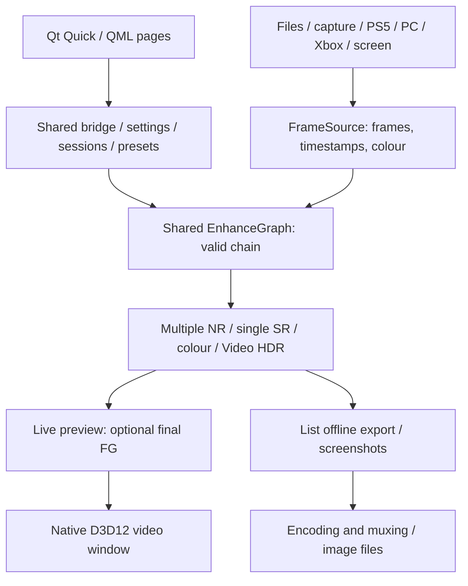

# Graphic Enhancement

**Real-time GPU video enhancement for Windows**

Super resolution · Denoising · HDR · Frame generation · Capture · PS5 / Xbox / PC streaming

Graphic Enhancement turns local video, capture cards and game streaming into one real-time GPU
enhancement pipeline. It runs on Windows 11 with DirectX 12 on NVIDIA and AMD GPUs.

> **Derived work.** Graphic Enhancement is a modified version of
> [Veyra](https://github.com/Likely7/Veyra-NRVideo) (upstream commit
> `bc59d457ce0b87141f3db2ebafb0f4812b1cea39`), released under the GNU GPL v3.
> The product was renamed and rebranded, upstream promotional material was removed and the
> fixes listed below were applied. See [NOTICE.md](NOTICE.md) for details. All original
> copyright and license notices are kept in [LICENSE](LICENSE), [licenses/](licenses) and
> [THIRD_PARTY_NOTICES.md](THIRD_PARTY_NOTICES.md).

## Features

- **Sources:** video files, capture cards, PS5 Remote Play, PC streaming (Moonlight/Sunshine
  compatible), Xbox (experimental) and screen capture.
- **Enhancement:** super resolution (DLSS / XeSS / FSR / NIS / VideoSR), up to four layered
  denoise (NR) passes, RTX Video HDR, anti-aliasing, colour grading (curves, wheels, LUTs).
- **Frame generation:** several backends with display sync / VRR options.
- **Editing modes:** Professional List mode and an executable Node editor.
- **Export:** ordered queue, trimming, MP4/MKV, multiple audio and subtitle tracks.
- **Extras:** live captions and translation, recording, OBS filter, virtual camera.
- **Languages:** Simplified and Traditional Chinese, English, Japanese, Korean, Spanish, French,
  German, Portuguese (Brazil), Russian and **Turkish** (new in this fork).
- **NVIDIA / AMD runtimes:** DLSS, DLSS 5 neural rendering (NR), VFG, RTX Video SR/HDR, FSR and
  AMD NR need their vendor runtime files; the GPU driver alone does not include all of them.

## Changes compared to upstream

1. **Launcher rollback only after an update.** Upstream rolled back to the previous version
   whenever the program exited with an error in its first 15 seconds, on any start. It now
   rolls back only on the first start of a freshly installed update.
2. **Tests run in CI.** Unit tests that need no GPU are registered with CTest and run by a new
   CI workflow on every push and pull request.
3. **Update signature test.** A unit test proves a valid signed manifest is accepted and a
   tampered one is rejected.
4. **WebVTT parsing.** Cues written without a blank line between them are no longer dropped.
5. **SRT parsing.** Timestamps with a `.` millisecond separator (`00:00:01.000`) are accepted.
6. **One atomic file writer.** Preset, session and UI preference files use the shared
   `writeSmallFile` helper (write to a temporary file, flush, then replace).

## Install

Windows 11 x64 and DirectX 12 are required. GPU and capture drivers are installed separately.
Start with all effects off, check picture and sound, then enable effects one by one. High
resolutions, layered NR and frame generation need more GPU memory.

Some runtimes and AI models are proprietary and are **not** part of this repository (see
[docs/DEVELOPMENT.md](docs/DEVELOPMENT.md)).

## Architecture

QML renders the interface; native D3D12 renders the video.

## Build

See [docs/DEVELOPMENT.md](docs/DEVELOPMENT.md) and [docs/ARCHITECTURE.md](docs/ARCHITECTURE.md).
Brand images are generated by `python tools/branding/make-branding.py`.

## License

Graphic Enhancement is free software under the [GNU GPL v3](LICENSE). The bundled Chiaki-based
PS5 streaming component is also subject to the AGPL-3.0 with an OpenSSL exception
([licenses/remoteplay](licenses/remoteplay)). Third-party components keep their own licenses;
see [THIRD_PARTY_NOTICES.md](THIRD_PARTY_NOTICES.md).
