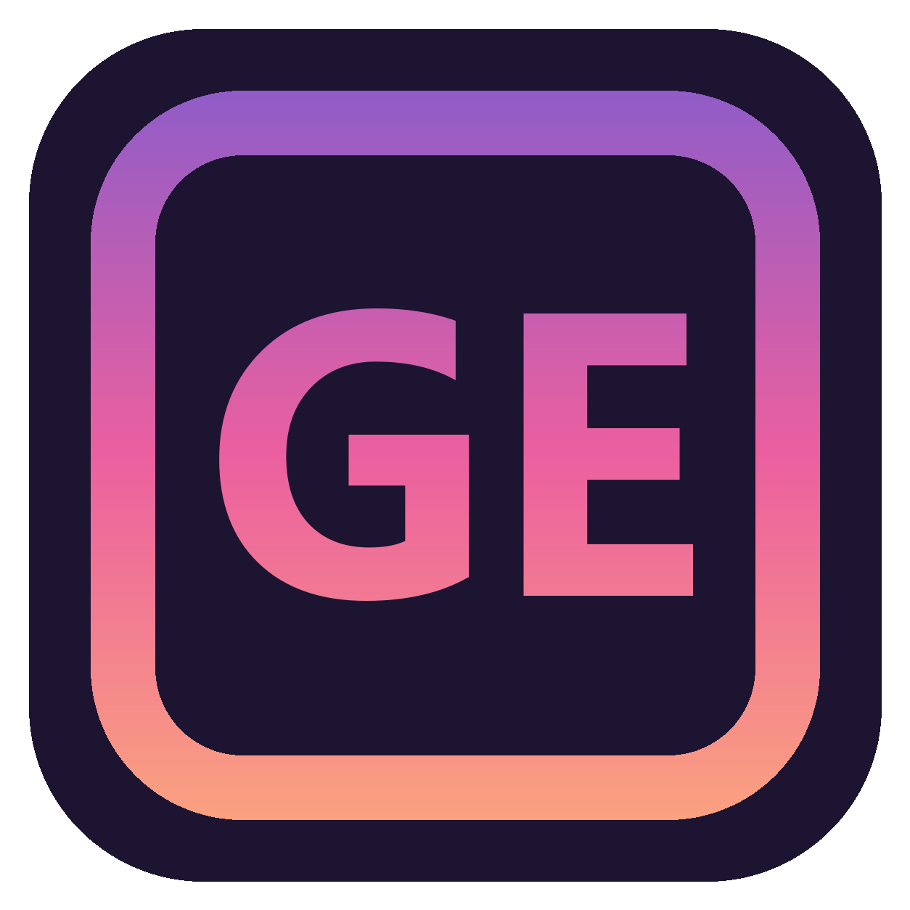

# Graphic Enhancement

**Windows için gerçek zamanlı GPU video iyileştirme**

Süper çözünürlük · Gürültü giderme · HDR · Kare üretimi · Yakalama · PS5 / Xbox / PC yayını

[English](README.md) · **Türkçe** · [🌐 Kendi dilinde web sitesi](https://nedimdmir.github.io/GraphicEnhancement/)

Graphic Enhancement; video dosyalarını, yakalama kartlarını ve oyun yayınlarını tek bir gerçek
zamanlı GPU iyileştirme hattında birleştirir. Windows 11 üzerinde DirectX 12 ile NVIDIA ve AMD
ekran kartlarında çalışır.

> **Türetilmiş çalışma.** Graphic Enhancement, GNU GPL v3 lisanslı
> [Veyra](https://github.com/Likely7/Veyra-NRVideo) projesinin (upstream commit
> `bc59d457ce0b87141f3db2ebafb0f4812b1cea39`) değiştirilmiş bir sürümüdür. Ürünün adı ve
> görselleri değiştirildi, upstream tanıtım içeriği kaldırıldı ve aşağıdaki değişiklikler
> yapıldı. Ayrıntılar [NOTICE.md](NOTICE.md) dosyasında. Özgün telif ve lisans bildirimleri
> [LICENSE](LICENSE), [licenses/](licenses) ve [THIRD_PARTY_NOTICES.md](THIRD_PARTY_NOTICES.md)
> içinde korunuyor.

## İndirme

`main` dalına yapılan her push GitHub Actions'ta derlenir. Son başarılı
[Windows build](https://github.com/nedimdmir/GraphicEnhancement/actions/workflows/windows-build.yml)
çalışmasını açın ve **Artifacts** altındaki ZIP'i indirin (GitHub, artifact indirmek için oturum
açmayı şart koşar). ZIP'i normal bir klasöre çıkarıp `graphicenhancement_qml_ui.exe` dosyasını
çalıştırın.

CI paketi NVIDIA/AMD'nin kapalı kaynak runtime'larını ve AI modellerini **içermez** (DLSS,
DLSS 5 nöral işleme, VFG, RTX Video, FSR, AMD NR). Ekran kartı sürücüsü bunları tek başına
sağlamaz; bunlar olmadan oynatma, renk ve ekran özellikleri çalışır ama bu iyileştirmeler
kullanılamaz.

## Özellikler

- **Kaynaklar:** video dosyaları, yakalama kartları, PS5 Remote Play, PC yayını
  (Moonlight/Sunshine uyumlu), Xbox (deneysel) ve ekran yakalama.
- **İyileştirme:** süper çözünürlük (DLSS / XeSS / FSR / NIS / VideoSR), dört katmana kadar
  gürültü giderme, DLSS 5 nöral işleme (NR), RTX Video HDR, kenar yumuşatma, renk düzenleme
  (eğriler, renk tekerlekleri, LUT).
- **Kare üretimi:** DLSS FG, NVIDIA VFG, FSR, XeSS, RIFE, AMD FRC; ekran senkronu ve VRR.
- **Düzenleme modları:** Pro liste modu ve çalıştırılabilir düğüm düzenleyici.
- **Dışa aktarma:** sıralı kuyruk, kırpma, MP4/MKV, birden çok ses ve altyazı parçası.
- **Ekstralar:** canlı altyazı ve çeviri, kayıt, anlık tekrar, OBS filtresi, sanal kamera.
- **14 arayüz dili:** English, Türkçe, 简体中文, 繁體中文, 日本語, 한국어, Español, Français,
  Deutsch, Português (Brasil), Русский, Italiano, Polski, Bahasa Indonesia.

## Upstream'e göre değişiklikler

1. **Varsayılan olarak daha düşük input lag.** İlk açılışta düşük gecikmeli sunum kuyruğu
   (3 yerine 1 kare) açık gelir; destekleyen sistemlerde NVIDIA Düşük Gecikme (Reflex) de açılır.
   Kayıtlı ayarlar korunur. İkisi de Pro modunda değiştirilebilir.
2. **Yeni diller:** Türkçe, İtalyanca, Lehçe ve Endonezce.
3. **Başlatıcı yalnızca güncellemeden sonra geri döner.** Upstream, program her açılışta ilk
   15 saniyede hata verirse önceki sürüme dönüyordu. Artık yalnızca yeni kurulan bir güncellemenin
   ilk açılışında geri dönüyor.
4. **CI her push'u derler ve test eder.** GPU gerektirmeyen birim testleri CI'da çalışır;
   derleyici hataları annotation olarak gösterilir.
5. **Güncelleme imza testi.** Geçerli imzalı manifest kabul edilir, değiştirilmiş olan reddedilir.
6. **WebVTT ayrıştırma.** Aralarında boş satır olmayan altyazılar artık kaybolmuyor.
7. **Derleme düzeltmesi.** VFG arka ucunun CUDA'sız derlemesi yeniden çalışıyor.
8. **Tek güvenli dosya yazıcı.** Preset, oturum ve arayüz tercih dosyaları ortak
   `writeSmallFile` fonksiyonunu kullanıyor (geçici dosyaya yaz, diske aktar, sonra değiştir).

## Gereksinimler

Windows 11 x64 ve DirectX 12. Ekran kartı ve yakalama kartı sürücüleri ayrıca kurulur. Tüm
efektler kapalıyken başlayın, görüntü ve sesi kontrol edin, sonra efektleri tek tek açın.
Yüksek çözünürlük, çok katmanlı NR ve kare üretimi daha fazla GPU belleği ister.

## Derleme

[docs/DEVELOPMENT.md](docs/DEVELOPMENT.md) ve [docs/ARCHITECTURE.md](docs/ARCHITECTURE.md)
dosyalarına bakın. Arayüz çevirileri [i18n/catalog.json](i18n/catalog.json) içindedir.

## Lisans

Graphic Enhancement, [GNU GPL v3](LICENSE) lisanslı özgür yazılımdır. Chiaki tabanlı PS5 yayın
bileşeni ayrıca OpenSSL istisnalı AGPL-3.0'a tabidir ([licenses/remoteplay](licenses/remoteplay)).
Üçüncü taraf bileşenler kendi lisanslarını korur; bkz.
[THIRD_PARTY_NOTICES.md](THIRD_PARTY_NOTICES.md).
